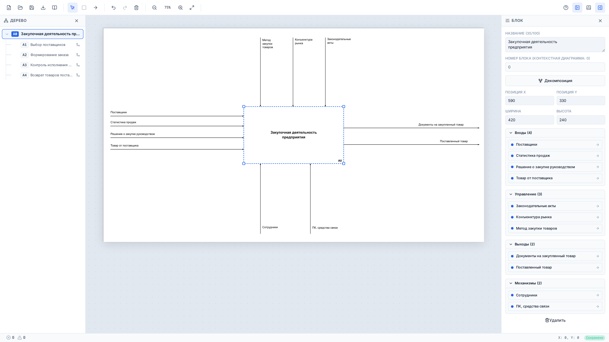
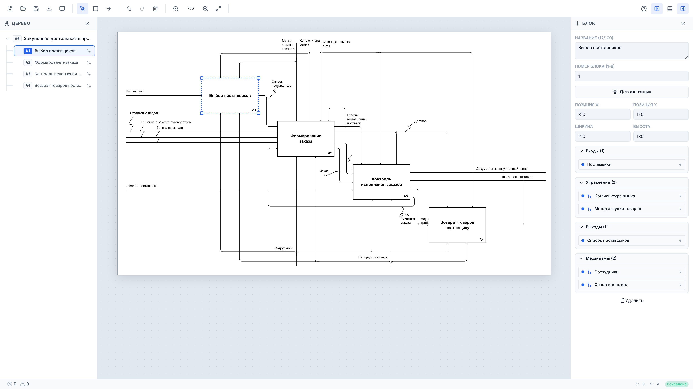

# IDEF0 Studio

Редактор функциональных диаграмм стандарта IDEF0.

## Интерфейс

### Контекстная диаграмма (A0)


### Диаграмма декомпозиции


## Как запустить

### Предварительные требования
* **Bun**
* **Java** (OpenJDK 21+)
* **make**

### Запуск через Makefile
```bash
make install    # Установка зависимостей
make build      # Сборка ClojureScript
make dev        # Запуск локального сервера (http://localhost:3000/)
make test       # Запуск модульных тестов
```
